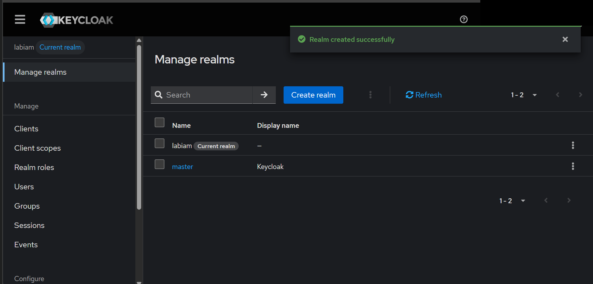
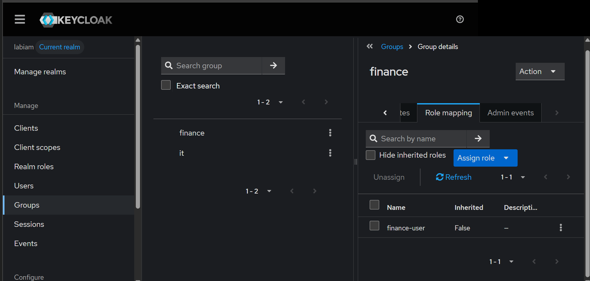
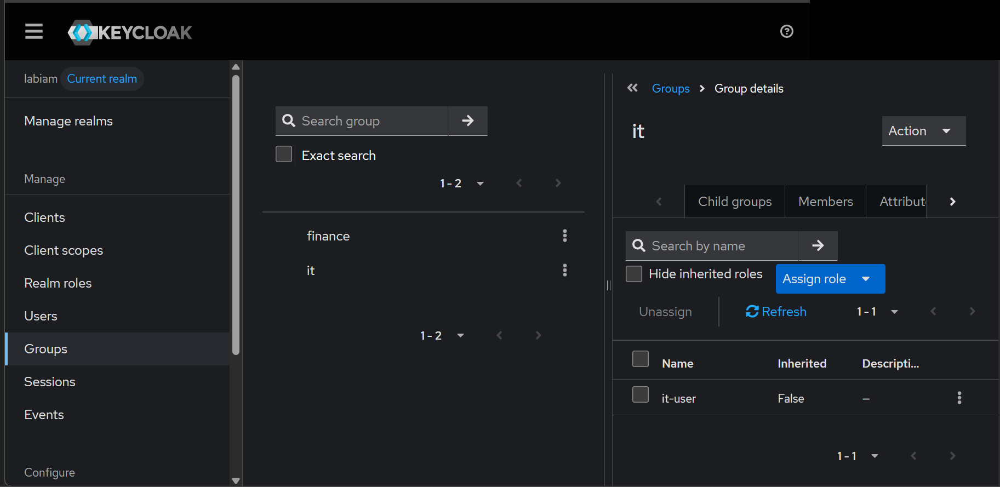
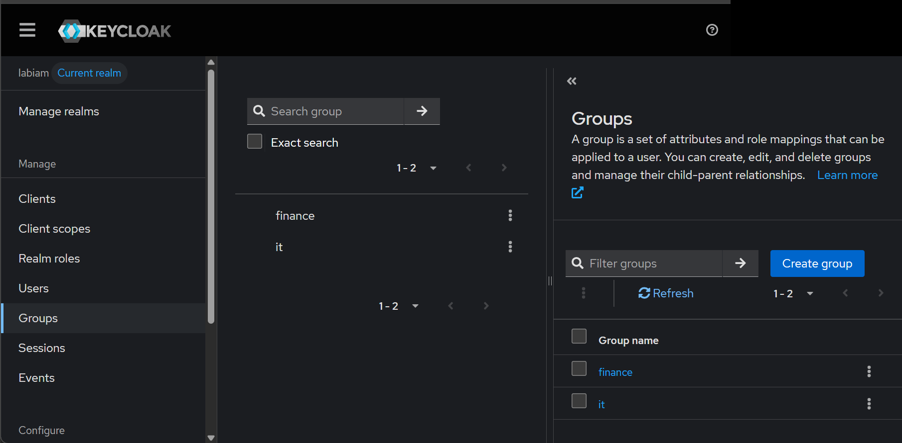
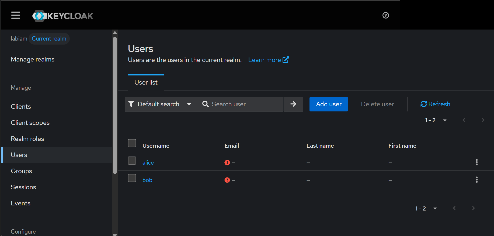
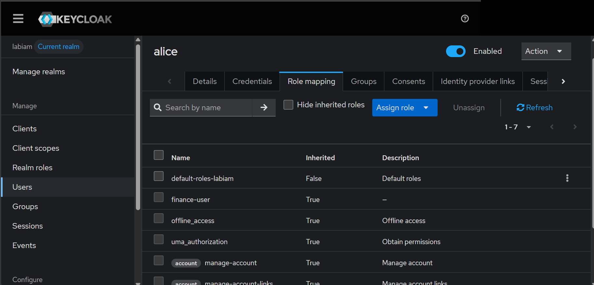
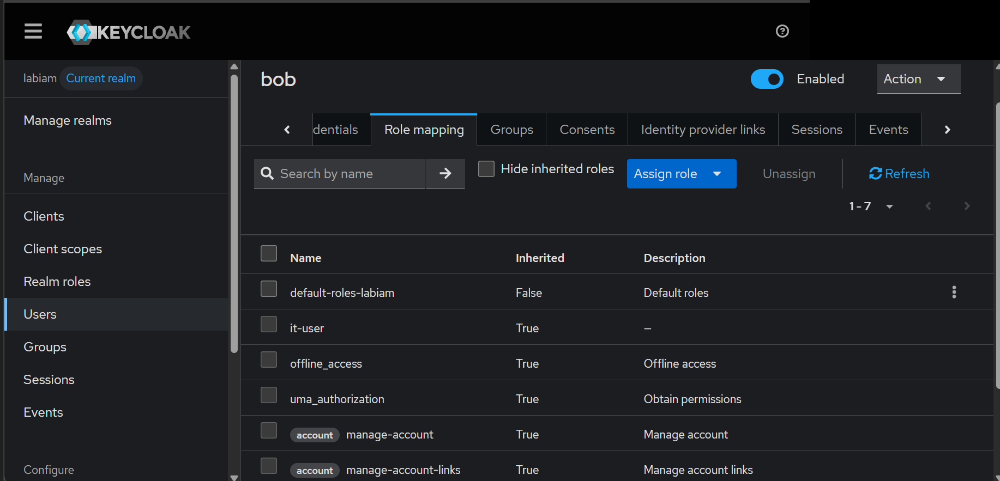
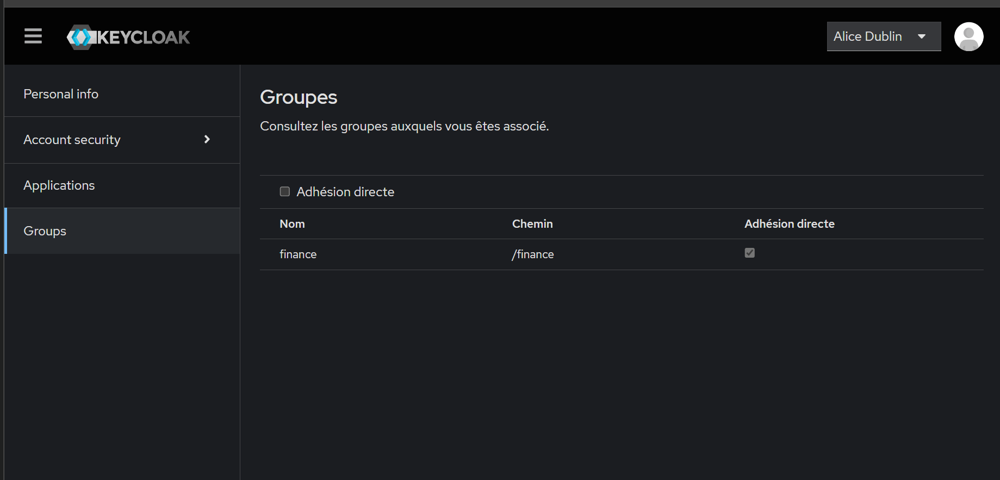
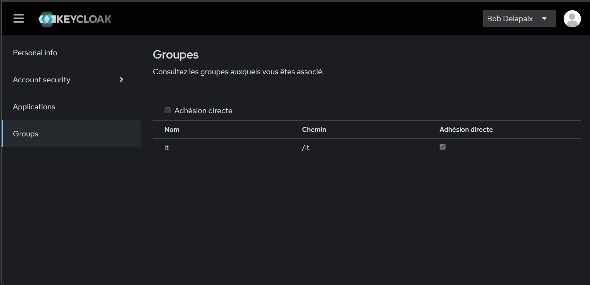

# Jalon 1 : socle Keycloak

## Objectif

Un Keycloak local avec deux utilisateurs, deux groupes et deux rôles, pour poser la chaîne d'accès **utilisateur → groupe → rôle** qui servira aux jalons suivants.

## Environnement

- Système : Windows, PC portable, 16 Go de RAM
- Java : 17.0.12 LTS (`java -version`)
- Keycloak : 26.8.1, archive zip, mode développement
- Commande de démarrage : `bin\kc.bat start-dev`
- Adresse : `http://localhost:8080` (local uniquement, jamais exposé sur Internet)
- Démarrage mesuré : environ 18 secondes

## Ce que j'ai fait

1. Installation de Java et vérification de la version.
2. Téléchargement de Keycloak et démarrage en mode `start-dev`.
3. Création du compte administrateur dans le realm `master`.
4. Création du realm `labiam` (le realm `master` reste réservé à l'administration).
5. Création des rôles `finance-user` et `it-user`.
6. Création des groupes `finance` et `it`, avec le rôle correspondant assigné au groupe.
7. Création des utilisateurs `alice` (groupe `finance`) et `bob` (groupe `it`), avec un mot de passe de test.
8. Connexion de chaque utilisateur à la console de compte (`/realms/labiam/account`).
9. Vérification de l'héritage des rôles dans l'onglet `Role mapping` de chaque utilisateur.

## Preuves (captures, sans mot de passe ni secret)

- [x] Le realm `labiam` créé

  

- [x] Les rôles assignés aux groupes

  
  
  

- [x] Les utilisateurs

  

- [x] Les rôles hérités par les groupes : alice reçoit `finance-user` (Inherited : True), bob reçoit `it-user` (Inherited : True), et chacun ne reçoit pas le rôle de l'autre

  
  

- [x] Connexion réussie d'alice et de bob

  
  

Les noms affichés dans les captures de connexion sont ceux des profils de test. Le nom de l'administrateur a été masqué sur les captures de la console d'administration.

## Schéma

```
alice → groupe finance → rôle finance-user
bob   → groupe it      → rôle it-user
```

Les rôles sont assignés **aux groupes**, pas aux utilisateurs. Ajouter un utilisateur à un groupe suffit pour lui donner ses droits, et le retirer du groupe les lui retire.

## Limites

- Mode `start-dev` : base de données intégrée, pas de HTTPS, réservé à un labo local.
- Pour l'instant, aucune application n'est protégée : tout utilisateur authentifié peut se connecter, et le contrôle d'accès par rôle n'est pas encore appliqué.

## Suite

Jalon 2 : créer deux applications de test (`compta` et `serveurs`), puis vérifier la matrice d'accès et observer les refus.
