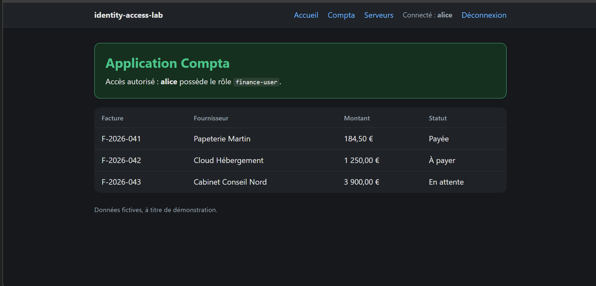
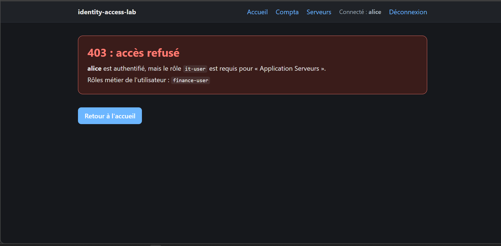
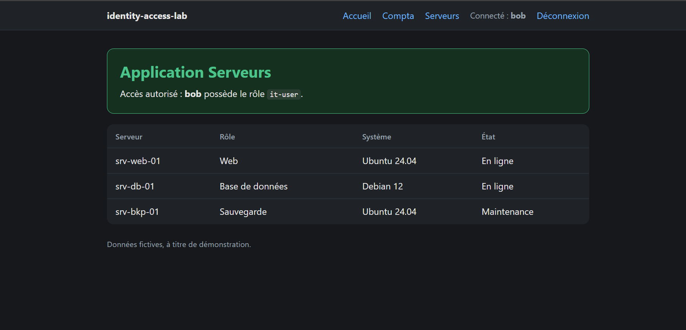
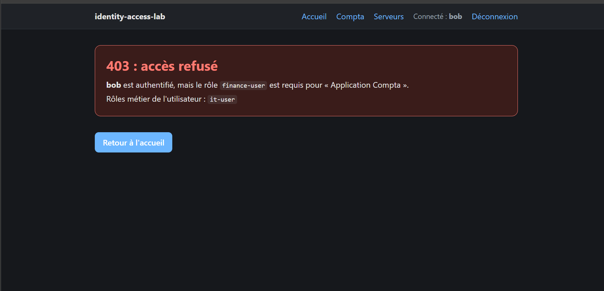

# Jalon 2 : autorisation par rôle

## Objectif

Une application de test qui authentifie les utilisateurs auprès de Keycloak, puis décide de l'accès à chaque ressource d'après le rôle contenu dans le jeton. Un utilisateur connecté mais sans le bon rôle reçoit une vraie erreur HTTP 403.

## Environnement

- Keycloak 26.8.1, realm `labiam`, adresse `http://localhost:8080`
- Python 3.14.3, environnement virtuel `.venv` (non versionné)
- Flask 3.1.3, Authlib 1.9.2, joserfc 1.7.7, requests 2.34.2, python-dotenv 1.2.4 (versions figées dans `app/requirements.txt`)
- Application : `http://localhost:5000` (127.0.0.1 uniquement)

## Ce que j'ai fait

1. Création du client `test-app` dans le realm `labiam` : OpenID Connect, authentification du client activée, flux standard, URI de redirection `http://localhost:5000/callback`.
2. Écriture d'une application Flask avec deux pages protégées : `/compta` (rôle `finance-user`) et `/serveurs` (rôle `it-user`).
3. Connexion via OpenID Connect (flux « authorization code »). Le secret du client est lu dans un fichier `.env` ignoré par Git.
4. Contrôle du jeton d'accès avant toute décision : signature RS256 vérifiée avec les clés publiques du realm, émetteur et expiration contrôlés.
5. Lecture des rôles dans `realm_access.roles` du jeton, puis décision : accès autorisé si le rôle exigé est présent, sinon 403. Un visiteur anonyme est redirigé vers la connexion.
6. Écriture de chaque décision dans `access.log` (une ligne JSON par événement), en vue du jalon 4.
7. Écriture de 10 tests automatiques, tous réussis (voir plus bas).
8. Test manuel des 4 cas avec alice et bob.

## Matrice d'accès vérifiée

| Utilisateur | `/compta` (`finance-user`) | `/serveurs` (`it-user`) |
|---|---|---|
| alice (groupe `finance`) | 200, autorisé | 403, refusé |
| bob (groupe `it`) | 403, refusé | 200, autorisé |

Un utilisateur connecté sans aucun rôle métier reçoit un 403 sur les deux pages (couvert par un test automatique, pas encore par un utilisateur Keycloak dédié).

## Preuves

- [x] alice sur `/compta` : accès autorisé

  

- [x] alice sur `/serveurs` : 403, le rôle `it-user` est requis

  

- [x] bob sur `/serveurs` : accès autorisé

  

- [x] bob sur `/compta` : 403, le rôle `finance-user` est requis

  

Les captures n'affichent pas le nom de l'administrateur ni aucun jeton ou secret.

## Journal des décisions

Extrait de `access.log` (heures en UTC) :

```
02:43:46  deny   bob    compta    required_role=finance-user
02:45:06  allow  bob    serveurs  required_role=it-user
02:46:32  allow  alice  compta    required_role=finance-user
02:47:01  deny   alice  serveurs  required_role=it-user
```

Chaque ligne contient l'heure, l'événement (`login`, `logout`, `access`, `login_failed`), l'utilisateur, la ressource, le rôle exigé, la décision et l'adresse IP. Le journal a aussi enregistré une tentative de connexion refusée pour un paramètre `state` invalide (`login_failed`, `MismatchingStateError`) : c'est la protection contre les requêtes de connexion forgées.

## Tests automatiques

`python -m unittest test_access -v` : 10 tests réussis, sans Keycloak.

- Matrice d'accès : visiteur anonyme redirigé, alice, bob, utilisateur sans rôle métier, contenu du journal, absence de jeton dans la page 403.
- Contrôle du jeton, avec de vraies clés RSA générées pour les tests : jeton valide accepté ; jeton expiré, mauvais émetteur et signature falsifiée refusés.

## Mesures de sécurité en place

- Refus par défaut : sans le rôle exigé, l'accès est refusé.
- Le jeton est vérifié (signature, émetteur, expiration) avant d'être utilisé.
- Cookie de session `HttpOnly` et `SameSite=Lax`.
- Les pages d'erreur n'affichent jamais le jeton.
- Redirection après connexion limitée aux chemins locaux.
- Secret du client et clé de session dans `.env`, ignoré par Git.

## Limites

- Une seule application avec deux pages protégées, pas deux applications séparées avec chacune son client Keycloak.
- Keycloak en `start-dev` et application sur le serveur de développement Flask, en HTTP : labo local uniquement.
- Les rôles sont lus à la connexion : un changement de rôle dans Keycloak n'est pris en compte qu'à la connexion suivante.
- Pas encore de MFA ni de politique de mot de passe.

## Suite

Jalon 3 : sécuriser les comptes (MFA, politique de mot de passe, durée des sessions) et vérifier l'effet sur la connexion.
