# Jalon 3 : sécurisation des comptes

## Objectif

Durcir l'authentification du realm `labiam` sans changer le code de l'application : imposer des mots de passe robustes, ajouter un second facteur (MFA) et limiter la durée des sessions.

## Environnement

- Keycloak 26.8.1, realm `labiam`, mode `start-dev`
- Application du jalon 2 inchangée (`http://localhost:5000`)
- Application d'authentification sur téléphone pour les codes à usage unique

## Ce que j'ai fait

1. **Politique de mot de passe** : longueur minimale 12, nom d'utilisateur interdit, au moins 1 chiffre, au moins 1 caractère spécial.
2. **Test de la politique** : réinitialisation du mot de passe de `bob` avec une valeur faible (refusée), puis avec une valeur conforme (acceptée).
3. **MFA** : action requise `Configure OTP` ajoutée à `alice` et à `bob`. À leur connexion suivante, chacun a enregistré un appareil en scannant un QR code dans l'application d'authentification.
4. **Vérification de la connexion avec MFA** : Keycloak demande le mot de passe, puis le code à usage unique. L'application du jalon 2 continue de fonctionner (bob accède à `/serveurs`, alice à `/compta`).
5. **Durée des sessions** : SSO Session Idle de 30 minutes à 2 minutes, SSO Session Max de 10 heures à 1 heure.
6. **Test de l'expiration** : session de `bob` visible dans la liste des sessions, puis absente environ 3 minutes 30 plus tard.

## Preuves

### Politique de mot de passe

- [x] Les 4 règles configurées

  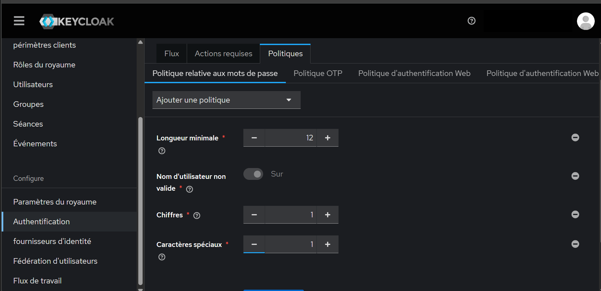

- [x] Un mot de passe faible est refusé (`Mot de passe invalide : longueur minimale 12`)

  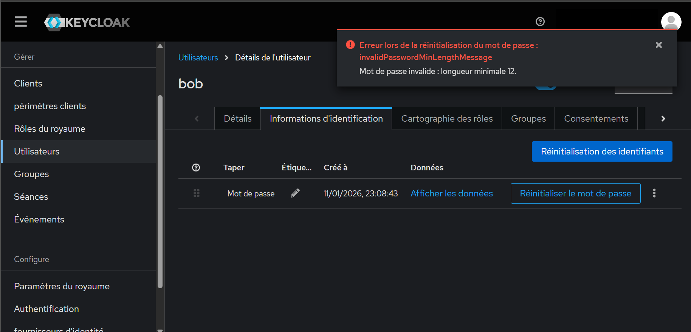

- [x] Un mot de passe conforme est accepté

  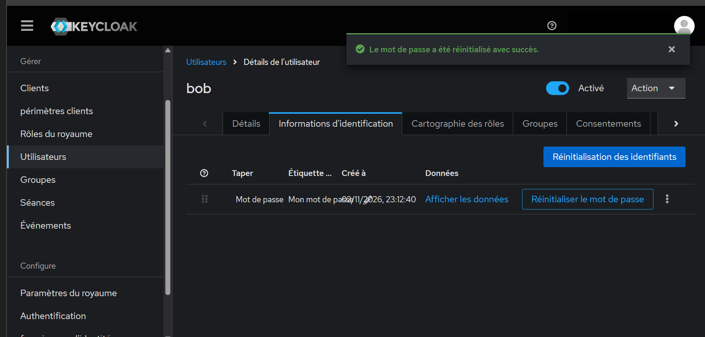

### MFA

- [x] Action requise `Configure OTP` sur alice

  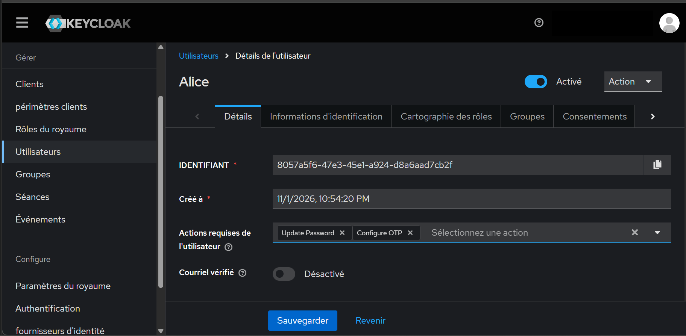

- [x] Après le mot de passe, Keycloak demande le code à usage unique

  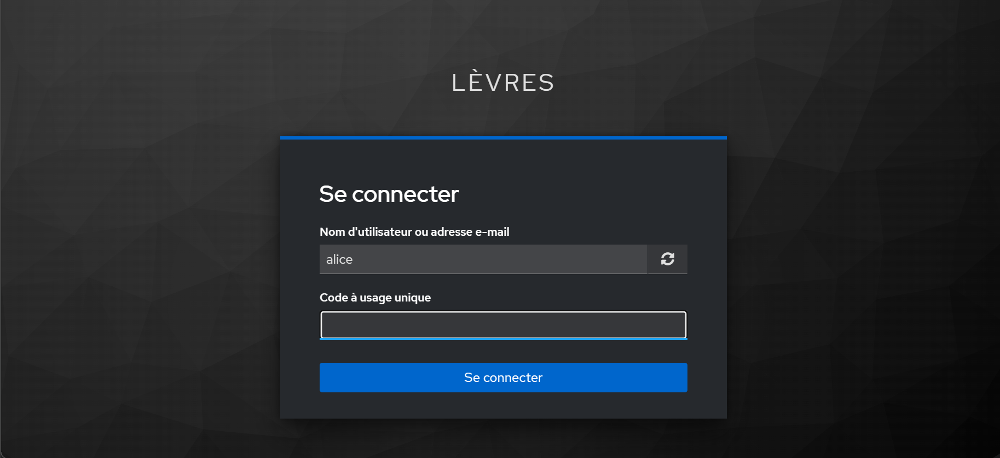
  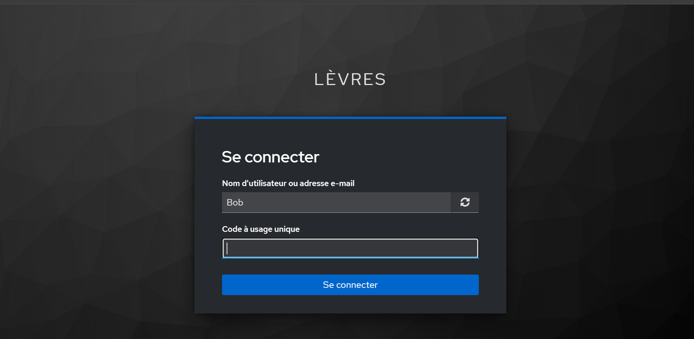

- [x] L'application reste accessible après une connexion avec code : bob sur `/serveurs`

  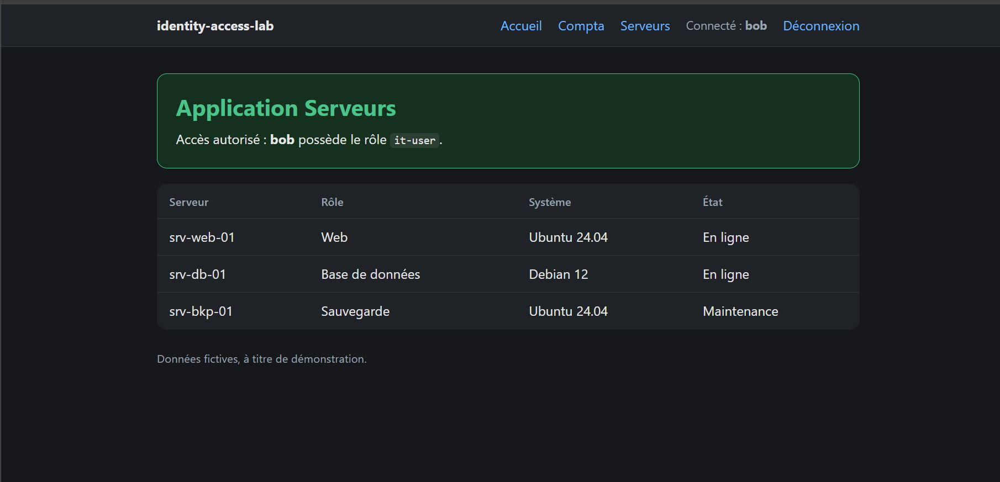

- [x] Paramètres OTP du realm : basé sur le temps, SHA1, 6 chiffres, période de 30 secondes, jeton non réutilisable

  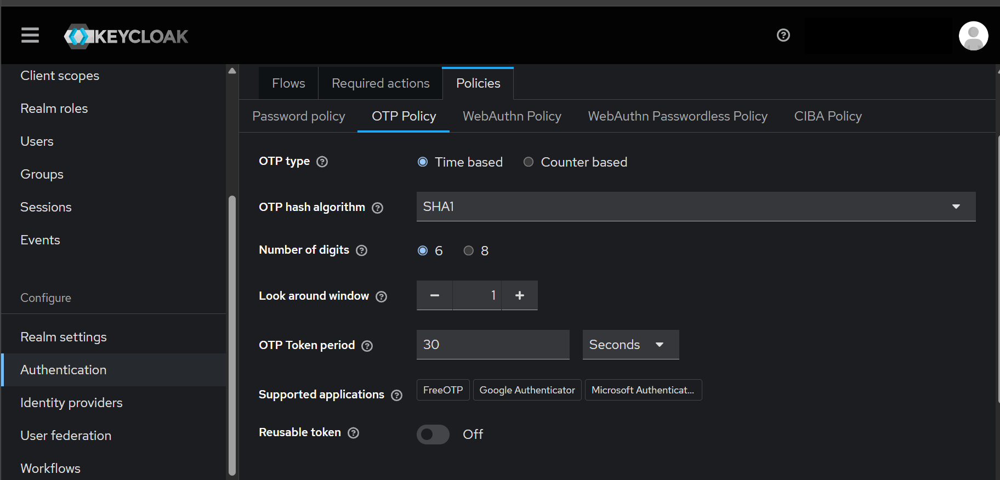

### Durée des sessions

- [x] Valeurs avant : SSO Session Idle 30 minutes, SSO Session Max 10 heures

  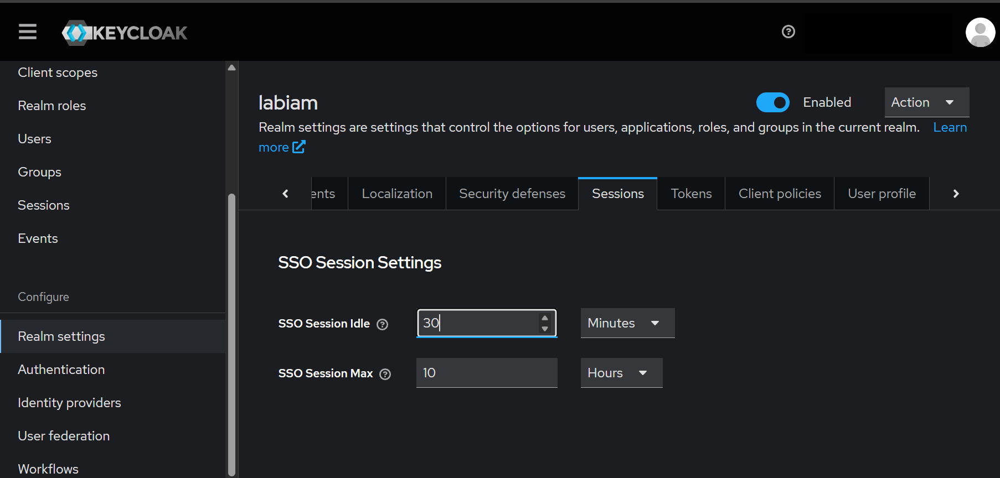

- [x] Valeurs après : SSO Session Idle 2 minutes, SSO Session Max 1 heure

  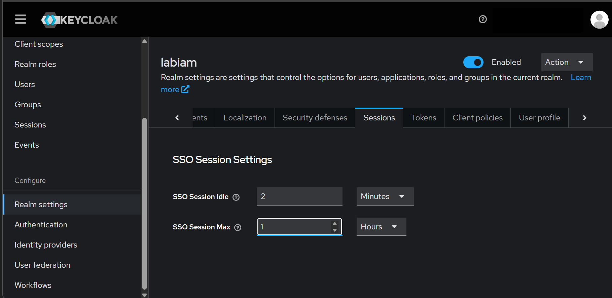

- [x] Session de `bob` active (démarrée à 14:19:08, dernier accès à 14:19:09)

  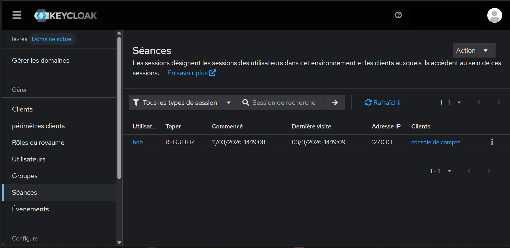

- [x] Plus aucune session environ 3 minutes 30 plus tard (capture de 14:22)

  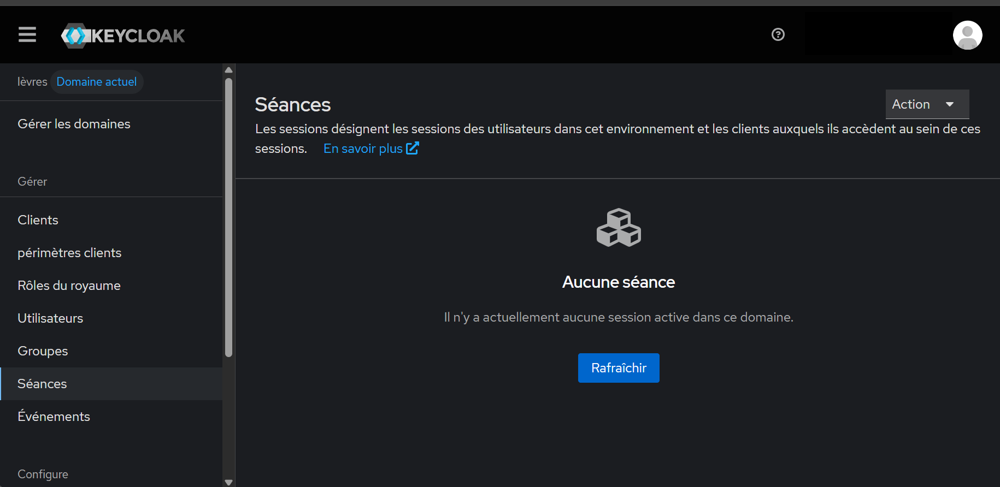

Les captures n'affichent ni mot de passe, ni QR code, ni clé secrète, ni le nom de l'administrateur.

## Résultats

| Contrôle | Avant | Après |
|---|---|---|
| Mot de passe | Aucune règle | 12 caractères minimum, 1 chiffre, 1 caractère spécial, différent du nom d'utilisateur |
| Connexion | Mot de passe seul | Mot de passe puis code à usage unique (alice, bob) |
| Session SSO inactive | 30 minutes | 2 minutes (valeur de labo) |
| Durée maximale d'une session SSO | 10 heures | 1 heure (valeur de labo) |

## Limites

- Les durées de session (2 minutes, 1 heure) sont volontairement courtes pour pouvoir les tester. Un environnement réel garderait des valeurs plus longues.
- Le MFA est activé utilisateur par utilisateur (action requise). Il n'est pas imposé à tout le realm : un nouvel utilisateur n'en aurait pas.
- Pas de codes de secours : la perte du téléphone impose une intervention d'un administrateur.
- La politique de mot de passe ne s'applique qu'aux nouveaux mots de passe, pas aux existants.
- L'application du jalon 2 garde sa propre session (cookie Flask) : l'expiration de la session Keycloak ne la ferme pas. Elle est contrôlée à la connexion, pas à chaque requête.
- Keycloak en `start-dev`, en HTTP : labo local uniquement.

## Suite

Jalon 4 : exploiter les journaux (celui de l'application et les événements de Keycloak) dans Wazuh ou Splunk, et créer 2 ou 3 alertes (par exemple des refus d'accès répétés ou des échecs de MFA).
