# Jalon 4 : journaux et détection

## Objectif

Envoyer les journaux de l'application (décisions d'accès) et de Keycloak (événements de connexion) dans un outil d'analyse, puis créer des alertes qui détectent des comportements suspects : refus d'accès répétés et échecs de connexion répétés.

## Environnement

- Splunk Enterprise, licence d'essai (60 jours à partir du 2026-11-03, 500 Mo par jour), interface `http://localhost:8000`, index `main`
- Keycloak 26.8.1, realm `labiam`, application du jalon 2 (`http://localhost:5000`)
- Les heures affichées par Splunk sont en UTC (« Greenwich »)
- Splunk tourne sous un compte de service sans droits d'administrateur : les journaux sont placés dans `C:\splunk-lab\`, un dossier qu'il peut lire

## Ce que j'ai fait

1. **Installation de Splunk Enterprise** (essai) et création du dossier `C:\splunk-lab\`.
2. **Journal de l'application** : variable `ACCESS_LOG=C:\splunk-lab\access.log` ajoutée au fichier `.env` (modèle dans `.env.example`). Entrée Splunk de type « Monitoring de fichier » en continu, sourcetype `_json`, index `main`. 46 événements indexés à la première lecture, avec les champs `decision`, `event`, `ip`, `required_role`, `resource`, `ts`, `user`.
3. **Journal de Keycloak** : ajout de trois lignes dans `conf/keycloak.conf` pour écrire aussi dans un fichier :

   ```
   log=console,file
   log-file=C:/splunk-lab/keycloak.log
   ```

   Entrée Splunk de type « Monitoring de fichier » en continu, sourcetype `log4j`, index `main`. Keycloak journalise chaque échec de connexion au niveau `WARN` (`type=LOGIN_ERROR`) avec `realmName`, `clientId`, `username`, `ipAddress` et `error`. Splunk extrait ces champs à la recherche.
4. **Alerte 1** `IAM - 3 refus d'acces en 5 min`, sur le journal de l'application :

   ```
   index=main event=access decision=deny | stats count by user | where count>=3
   ```

5. **Alerte 2** `IAM - Echecs de connexion repetes (Keycloak)`, sur le journal de Keycloak :

   ```
   index=main source="C:\\splunk-lab\\keycloak.log" type=LOGIN_ERROR | stats count by username | where count>=3
   ```

6. **Tests** : refus d'accès répétés pour alice (alerte 1), puis mauvais mots de passe répétés pour alice (alerte 2).

## Réglages des alertes

| Réglage | Alerte 1 | Alerte 2 |
|---|---|---|
| Type | Planifié, cron `*/1 * * * *` (chaque minute) | Idem |
| Intervalle de temps | 5 minutes avant, jusqu'à maintenant | Dernière 5 minutes |
| Condition | Nombre de résultats supérieur à 0 | Idem |
| Déclenchement | Pour chaque résultat | Idem |
| Throttle | Champ `user`, 5 minutes | Champ `username`, 5 minutes |
| Action | Ajouter aux alertes déclenchées | Idem |
| Gravité | Moyenne | Moyenne |

## Preuves

### Sources de données

- [x] Journal de l'application : entrée de fichier en continu, sourcetype `_json`

  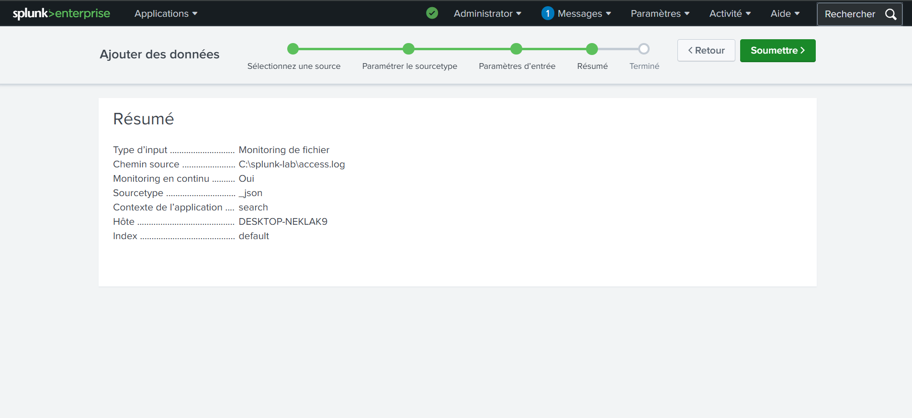

- [x] Journal de l'application lu par Splunk : 46 événements, champs extraits (exemple : `decision: deny`, `resource: serveurs`, `user: alice`)

  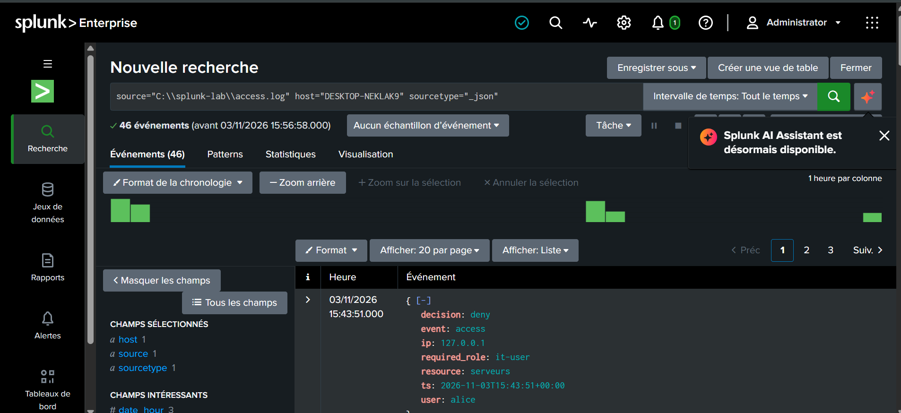

- [x] Journal de Keycloak : entrée de fichier en continu, sourcetype `log4j`

  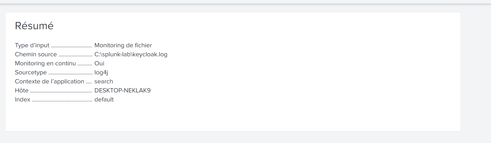

- [x] Échecs de connexion Keycloak lus par Splunk : `alice`, `invalid_user_credentials`, 2 événements

  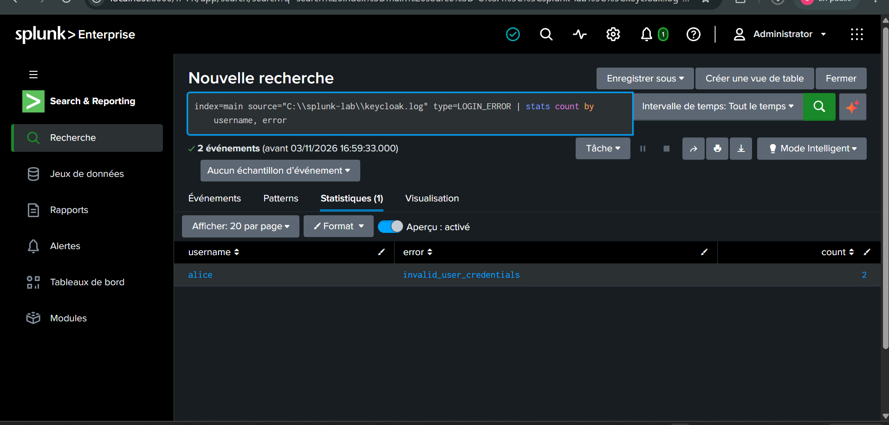

### Alerte 1 : refus d'accès répétés

- [x] Recherche sur toute la période : 17 refus au total, alice 11 et bob 6

  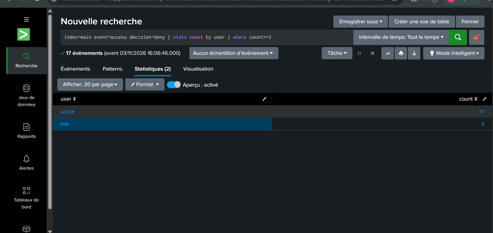

- [x] Planification Cron `*/1 * * * *` (l'intervalle de temps est réglé à l'étape suivante)

  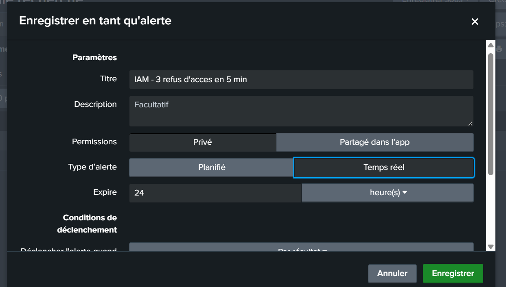

- [x] Intervalle relatif : 5 minutes avant, jusqu'à maintenant

  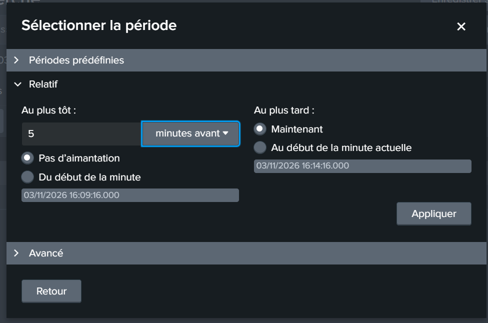

- [x] Throttle sur `user` pendant 5 minutes, action « Ajouter aux alertes déclenchées », gravité Moyenne

  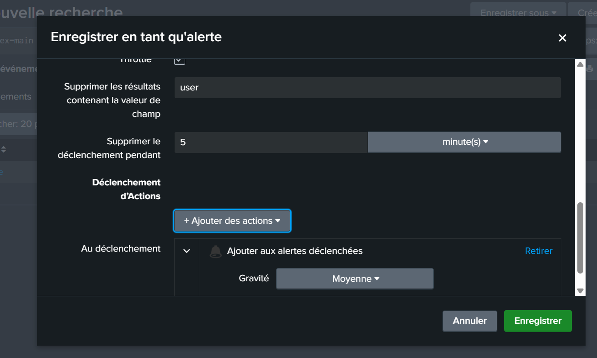

- [x] Dans la fenêtre du 2026-11-03 16:24 à 16:29, la recherche renvoie `alice` avec 4 refus

  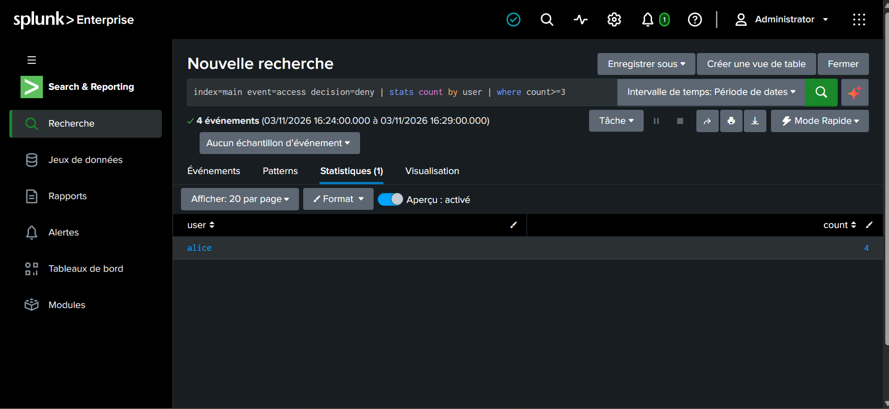

### Alerte 2 : échecs de connexion répétés

- [x] Type Planifié, intervalle « Dernière 5 minutes », cron `*/1 * * * *`

  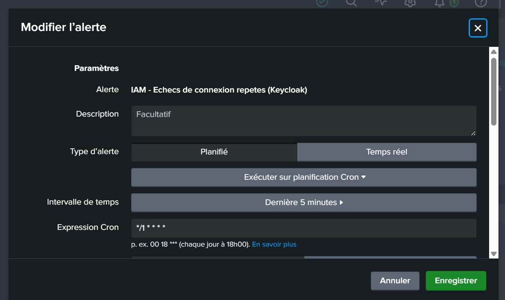

- [x] Déclenchement si nombre de résultats supérieur à 0, « Pour chaque résultat », throttle sur `username`

  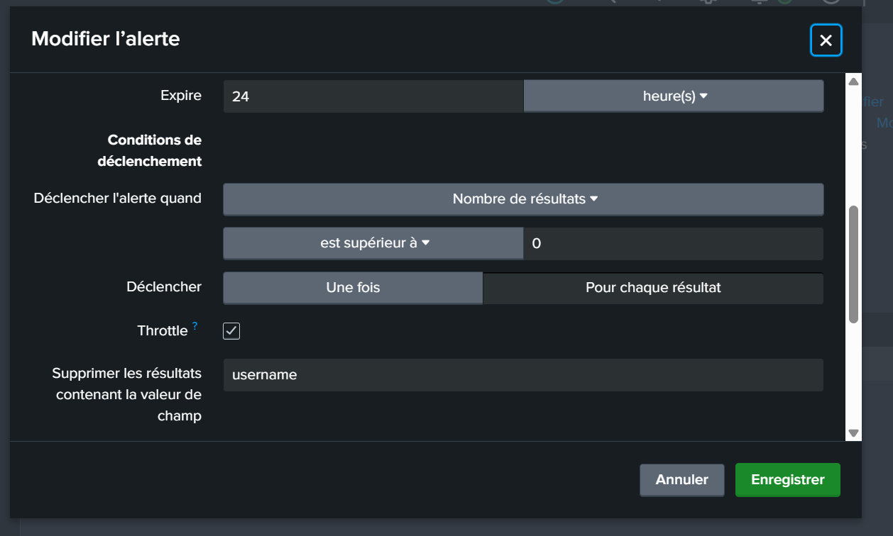

- [x] Throttle de 5 minutes, action « Ajouter aux alertes déclenchées », gravité Moyenne

  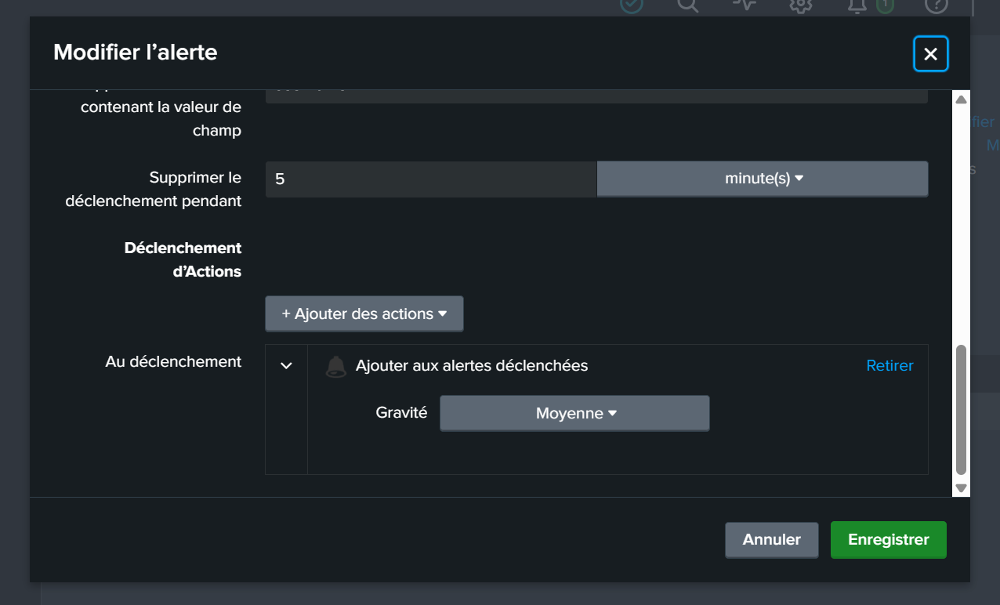

- [x] Les deux alertes sont activées et planifiées (prochaine exécution 18:04:00)

  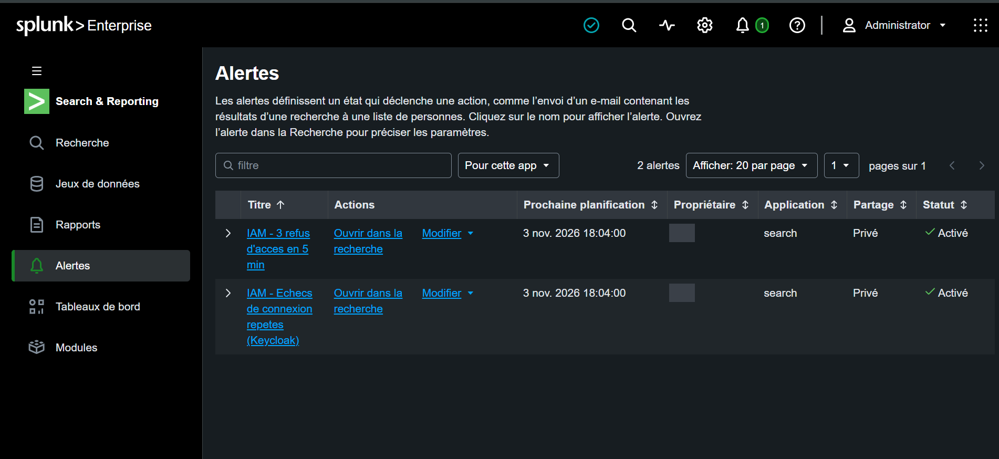

### Déclenchements

- [x] Alertes déclenchées : alerte 1 à 16:29:02 et 16:35:03, alerte 2 à 17:13:04, 17:18:06 et 18:08:02

  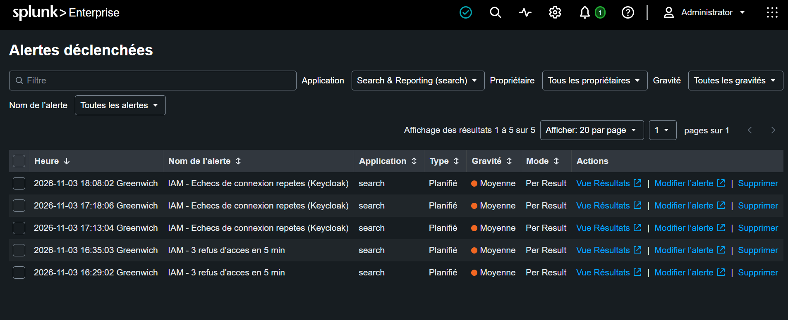

- [x] Test de l'alerte 2 dans le realm `labiam` : trois échecs d'alice sur `test-app` (`invalid_user_credentials`) à 18:06:38, 18:06:42 et 18:07:00, alerte déclenchée à 18:08:02. La quatrième ligne (`master`, `security-admin-console`, `expired_code`, 18:07:22) vient de la console d'administration et n'a pas de nom d'utilisateur.

  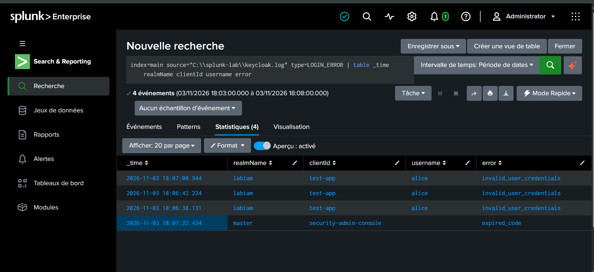

Les captures n'affichent pas le propriétaire des alertes (masqué), ni mot de passe, ni jeton, ni secret. Le nom d'hôte de la machine et le nom d'affichage par défaut de Splunk (`Administrator`) restent visibles.

## Résultats

| Détection | Source | Seuil | Résultat du test |
|---|---|---|---|
| Refus d'accès répétés | `access.log` (application) | 3 refus ou plus par utilisateur en 5 minutes | Alerte déclenchée (alice, 4 refus dans la fenêtre) |
| Échecs de connexion répétés | `keycloak.log` (Keycloak) | 3 échecs ou plus par nom d'utilisateur en 5 minutes | Alerte déclenchée à 18:08:02 (alice, 3 échecs dans `labiam`) |

Un premier test de l'alerte 2 à 17:13 est parti de la console d'administration (realm `master`, erreur `user_not_found`) : l'alerte s'est déclenchée aussi, parce qu'elle compte par nom d'utilisateur sans filtrer le realm. À 17:18:06, elle s'est déclenchée de nouveau à la fin du throttle, avec les mêmes événements encore dans la fenêtre de 5 minutes. Le test de référence est celui de 18:06, dans `labiam`.

## Limites

- Licence d'essai de Splunk : 60 jours à partir du 2026-11-03 (fin vers le 2027-01-02). Les alertes planifiées s'arrêteront ensuite, la licence gratuite n'incluant pas les alertes d'après la documentation de Splunk.
- Les alertes n'ajoutent qu'une ligne à la liste des alertes déclenchées : pas d'e-mail, pas de ticket. La gravité est restée à la valeur par défaut (Moyenne).
- L'alerte 2 compte par nom d'utilisateur, sans filtre sur le realm ni sur l'adresse IP. Elle ne détecte pas les échecs de MFA.
- Les journaux (`C:\splunk-lab\`), la configuration de Splunk et `conf/keycloak.conf` ne sont pas dans le dépôt. Les étapes pour les recréer sont dans le README.
- Splunk et Keycloak en HTTP sur la machine locale : labo uniquement.
- Wazuh n'est pas utilisé : le jalon est fait avec Splunk.

## Suite

Jalon 5 (optionnel) : connexion OIDC de Kubernetes avec Keycloak et RBAC au moindre privilège.
