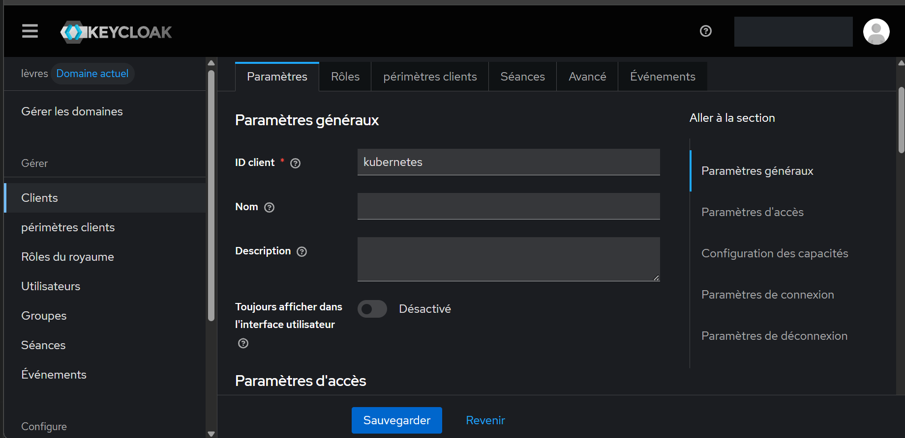
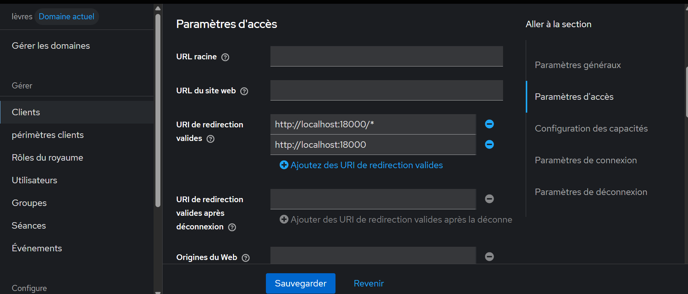
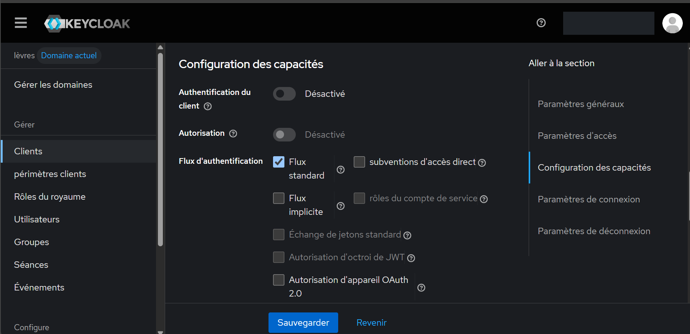
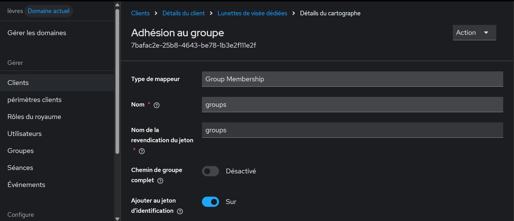
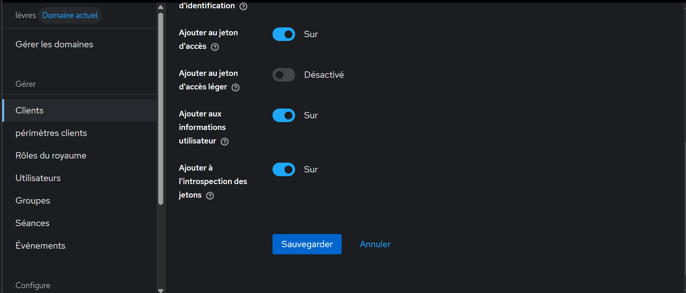
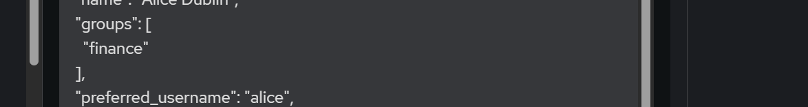
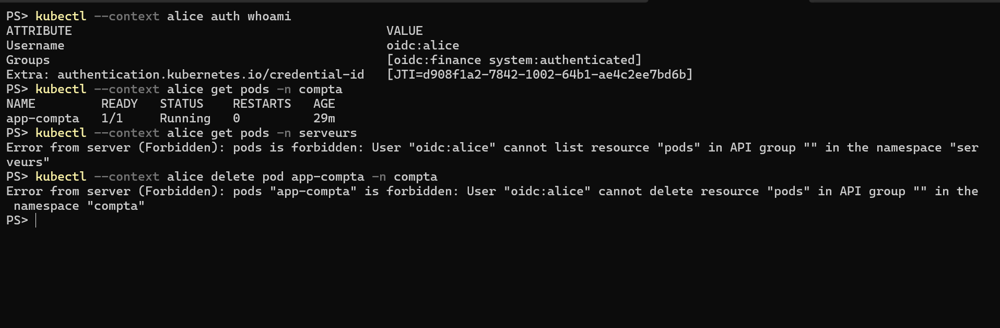
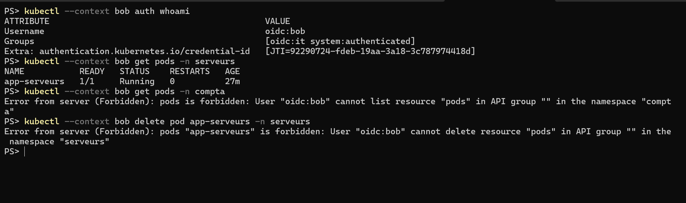
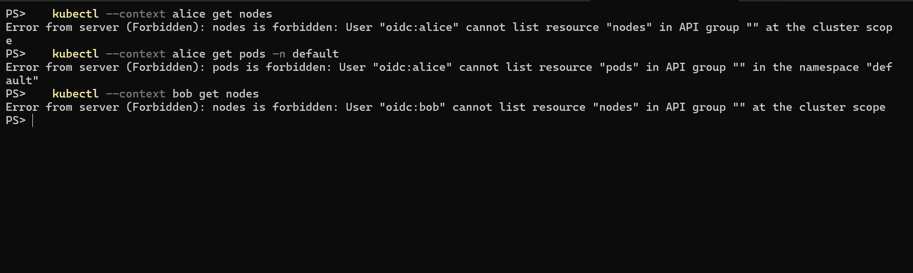

# Jalon 5 : Kubernetes, connexion OIDC avec Keycloak et RBAC

## Objectif

Un cluster Kubernetes local qui authentifie ses utilisateurs auprès de Keycloak (OpenID Connect) et applique les mêmes droits que l'application du jalon 2 : alice (groupe `finance`) ne lit que le namespace `compta`, bob (groupe `it`) ne lit que le namespace `serveurs`. Tout le reste est refusé.

## Environnement

- Docker Desktop 4.89.0 (WSL2), kind 0.33.0, nœud `kindest/node:v1.37.0` (Kubernetes 1.37.0), `kubectl` 1.36.1
- kubelogin (`int128/kubelogin`), installé comme plugin `kubectl oidc-login`
- Keycloak 26.8.1, realm `labiam`, joignable en HTTPS sur `https://host.docker.internal:8444`
- Fichiers hors dépôt dans `C:\k8s-lab\` : certificat de Keycloak, plugin, caches de jetons

## Ce que j'ai fait

1. **HTTPS pour Keycloak** : Kubernetes n'accepte un fournisseur OIDC qu'en HTTPS. Certificat auto-signé généré avec `keytool` (RSA 2048, 365 jours, noms `host.docker.internal`, `localhost` et `127.0.0.1`), puis ajout dans `conf/keycloak.conf` :

   ```
   https-key-store-file=C:/k8s-lab/keycloak.p12
   https-key-store-password=<mot de passe du fichier>
   https-port=8444
   http-host=0.0.0.0
   ```

   Le port 8443 par défaut est occupé par Docker Desktop. L'application du jalon 2 reste sur `http://localhost:8080`.
2. **Nom `host.docker.internal`** : sous Windows, Docker Desktop l'avait écrit dans le fichier `hosts` avec l'ancienne adresse de la machine (`192.168.1.3`, alors que le Wi-Fi était en `192.168.1.4`). Je l'ai remplacé par `127.0.0.1`. Depuis un conteneur, Docker résout ce nom lui-même.
3. **Client Keycloak `kubernetes`** (realm `labiam`) : client public (authentification du client désactivée), flux standard seulement (accès direct désactivé), URI de redirection `http://localhost:18000` et `http://localhost:18000/*`. Le port 18000 évite le port 8000 par défaut de kubelogin, occupé par Splunk.
4. **Groupes dans le jeton** : mappeur « Group Membership » (nom de la revendication `groups`, chemin complet désactivé, ajouté aux jetons d'ID et d'accès, à userinfo et à l'introspection). Jeton évalué pour alice : `"groups": ["finance"]` ; pour bob : `"groups": ["it"]`.
5. **Cluster** : `kind create cluster --name labiam --config 05-kubernetes/kind-config.yaml`. Le fichier monte le certificat de Keycloak dans le nœud et règle le serveur d'API : émetteur `https://host.docker.internal:8444/realms/labiam`, client `kubernetes`, utilisateur lu dans `preferred_username`, groupes lus dans `groups`, préfixe `oidc:` sur les deux, certificat `oidc-ca-file`. Les sept réglages ont été relus dans le processus du serveur d'API :

   ```
   oidc-issuer-url=https://host.docker.internal:8444/realms/labiam
   oidc-client-id=kubernetes
   oidc-username-claim=preferred_username
   oidc-username-prefix=oidc:
   oidc-groups-claim=groups
   oidc-groups-prefix=oidc:
   oidc-ca-file=/etc/kubernetes/pki/keycloak-ca.crt
   ```

6. **RBAC** (`05-kubernetes/rbac.yaml`) : namespaces `compta` et `serveurs`, un rôle `lecture-seule` dans chacun (`get`, `list`, `watch` sur pods, journaux de pods, services, configmaps et deployments), lié au groupe `oidc:finance` pour `compta` et au groupe `oidc:it` pour `serveurs`. Un pod `nginx:alpine` de démonstration par namespace (`app-compta`, `app-serveurs`). Aucun `ClusterRole` n'est attribué.
7. **Contrôle des règles par simulation d'identité** (`kubectl auth can-i … --as=… --as-group=…`) :

   | Commande | Résultat |
   |---|---|
   | alice, lister les pods de `compta` | yes |
   | alice, lister les pods de `serveurs` | no |
   | bob, lister les pods de `serveurs` | yes |
   | bob, lister les pods de `compta` | no |
   | alice, supprimer un pod de `compta` | no |

8. **Connexion réelle** : une entrée `alice` et une entrée `bob` dans `kubeconfig`, qui appellent `kubectl oidc-login get-token` (émetteur `https://host.docker.internal:8444/realms/labiam`, client `kubernetes`, certificat de Keycloak, écoute sur `127.0.0.1:18000`, un dossier de cache par utilisateur, navigateur ouvert à la main dans une fenêtre privée). Chaque utilisateur s'authentifie sur Keycloak avec son mot de passe puis son code à usage unique.

## Preuves

### Configuration de Keycloak

- [x] Client `kubernetes`

  

- [x] URI de redirection valides : `http://localhost:18000/*` et `http://localhost:18000`

  

- [x] Authentification du client désactivée (client public), flux standard activé, accès direct désactivé

  

- [x] Mappeur de groupes : revendication `groups`, chemin complet désactivé, jeton d'ID activé

  

- [x] Même mappeur : jeton d'accès, userinfo et introspection activés

  

- [x] Jeton d'ID généré pour alice : `groups` contient `finance`

  

### Accès au cluster avec de vrais jetons

- [x] alice : identité `oidc:alice`, groupe `oidc:finance` ; pods de `compta` visibles ; `Forbidden` sur `serveurs` et sur la suppression d'un pod

  

- [x] bob : identité `oidc:bob`, groupe `oidc:it` ; pods de `serveurs` visibles ; `Forbidden` sur `compta` et sur la suppression d'un pod

  

- [x] Refus par défaut : alice et bob ne peuvent pas lister les nœuds, alice ne peut pas lister les pods du namespace `default`

  

Les captures n'affichent ni mot de passe, ni code à usage unique, ni secret, ni le nom de l'administrateur. La console Keycloak y apparaît traduite automatiquement par le navigateur : « lèvres » désigne le realm `labiam`.

## Résultats

| Utilisateur | Groupe Keycloak | Groupe Kubernetes | `compta` (lecture) | `serveurs` (lecture) | Suppression | Nœuds, `default` |
|---|---|---|---|---|---|---|
| alice | `finance` | `oidc:finance` | autorisé | refusé | refusée | refusés |
| bob | `it` | `oidc:it` | refusé | autorisé | refusée | refusés |

Le jeton d'accès généré par Keycloak a une durée de 300 secondes (différence entre `exp` et `iat`).

## Limites

- Cluster kind d'un seul nœud sur la machine locale, sans stockage ni réseau externes : labo uniquement.
- Certificat de Keycloak auto-signé, donné au serveur d'API par fichier. Un environnement réel utiliserait une autorité de certification reconnue.
- `http-host=0.0.0.0` rend Keycloak (mode développement) joignable par les autres appareils du réseau local : à retirer de `keycloak.conf` hors du labo. Docker Desktop peut aussi réécrire la ligne `host.docker.internal` du fichier `hosts` à un prochain démarrage.
- Les groupes sont lus dans le jeton à la connexion : un changement de groupe dans Keycloak n'est pris en compte qu'à l'obtention d'un nouveau jeton.
- Droits en lecture seule uniquement, par namespace ; pas de `ClusterRole`, pas de droits d'écriture pour alice et bob. Les rôles de realm `finance-user` et `it-user` ne sont pas utilisés par Kubernetes, seuls les groupes le sont.
- Le compte administrateur du cluster (certificat créé par kind) n'est pas relié à Keycloak.
- Jetons mis en cache dans `C:\k8s-lab\cache-alice` et `C:\k8s-lab\cache-bob`, hors dépôt.
- Les fichiers `kind-config.yaml` et `rbac.yaml` sont versionnés ; le certificat, le fichier `.p12`, le mot de passe et les caches ne le sont pas.
