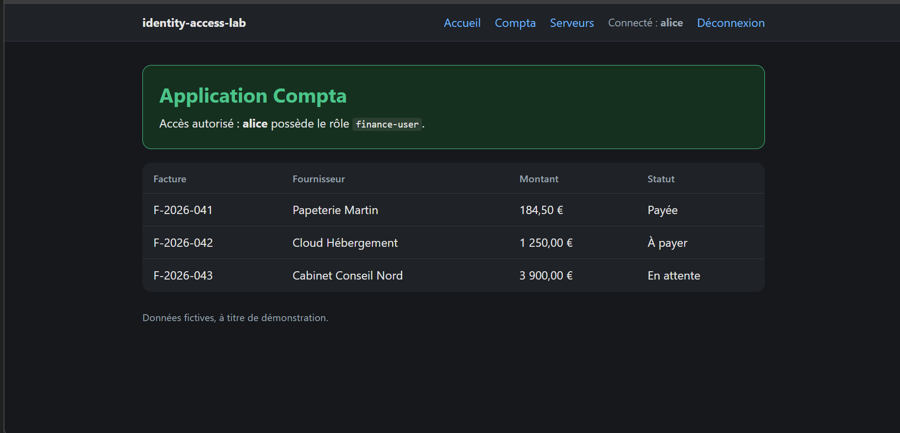
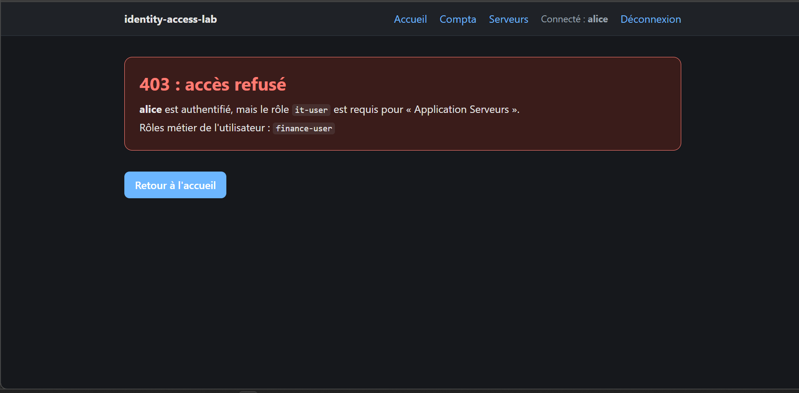

# identity-access-lab

Authentification, autorisation et détection avec Keycloak, Splunk et Kubernetes.

Labo personnel pour comprendre et démontrer la gestion des identités et des accès (IAM) : qui peut se connecter, qui peut accéder à quoi, et comment le vérifier dans les journaux.

## Résultat en bref

- Un Keycloak local (realm `labiam`) avec deux utilisateurs, deux groupes et deux rôles. Les rôles sont portés par les groupes, les utilisateurs les héritent.
- Une application de test qui authentifie via OpenID Connect, vérifie le jeton (signature, émetteur, expiration) et décide de l'accès d'après le rôle.
- Un utilisateur connecté sans le bon rôle reçoit une vraie erreur **403**, pas un simple message.
- Chaque décision (autorisé ou refusé) est écrite dans un journal JSON, prêt pour l'analyse à l'étape suivante.
- Mots de passe contrôlés par une politique, second facteur par code à usage unique (MFA) et sessions limitées dans le temps (jalon 3).
- Les journaux de l'application et de Keycloak sont lus par Splunk, avec 2 alertes planifiées testées : refus d'accès répétés et échecs de connexion répétés (jalon 4).
- Un cluster Kubernetes local qui accepte les comptes Keycloak (OIDC) : alice ne lit que le namespace `compta`, bob que `serveurs`, tout le reste est refusé (jalon 5).
- 10 tests automatiques, sans Keycloak, dont le refus des jetons expirés, falsifiés ou émis par un autre realm.

| alice sur Compta : autorisé | alice sur Serveurs : 403 |
|---|---|
|  |  |

## Question centrale

Un utilisateur peut s'authentifier sans être autorisé : se connecter ne donne pas accès aux ressources. Ce labo montre pourquoi et comment le diagnostiquer.

## Scénario

Deux utilisateurs, deux groupes, deux ressources protégées.

| | Page Compta (rôle `finance-user`) | Page Serveurs (rôle `it-user`) |
|---|---|---|
| alice (groupe `finance`) | Oui | Non |
| bob (groupe `it`) | Non | Oui |

Chaîne d'accès : utilisateur, groupe, rôle, permission, ressource. Par défaut, tout est refusé (moindre privilège).

## Jalons

| Jalon | Contenu | État |
|---|---|---|
| [1. Socle](01-socle/NOTES.md) | Keycloak local, realm, utilisateurs, groupes, rôles | Terminé |
| [2. Autorisation](02-autorisation/NOTES.md) | Application de test, deux pages protégées par rôle, erreurs 403, journal des décisions | Terminé |
| [3. Sécurisation](03-securisation/NOTES.md) | Politique de mot de passe, MFA (code à usage unique), durée des sessions | Terminé |
| [4. Journaux et détection](04-journaux/NOTES.md) | Journaux de l'application et de Keycloak lus par Splunk, 2 alertes (refus d'accès répétés, échecs de connexion répétés) | Terminé |
| [5. Kubernetes](05-kubernetes/NOTES.md) | Connexion OIDC avec Keycloak, RBAC au moindre privilège (lecture seule par namespace) | Terminé |

## Technologies

Keycloak 26.8.1, OpenID Connect, Python 3 avec Flask, Authlib et joserfc, Splunk Enterprise (licence d'essai), Docker Desktop, kind, Kubernetes, kubectl et kubelogin, Git.

## Prérequis

- Windows, 16 Go de RAM recommandés
- OpenJDK 17 (version exigée par la version de Keycloak utilisée)
- Keycloak, installé depuis l'archive zip (non versionné dans ce dépôt)
- Python 3.10 ou plus récent (jalon 2)
- Splunk Enterprise, licence d'essai de 60 jours (jalon 4)
- Docker Desktop (WSL2), kind, `kubectl` et kubelogin (jalon 5)

## Reproduire le labo

### Jalon 1 : Keycloak

1. Télécharger Keycloak 26.8.1 (archive zip), l'extraire, puis lancer depuis le dossier qui contient `bin` :

   ```powershell
   bin\kc.bat start-dev
   ```

2. Ouvrir `http://localhost:8080`, créer le compte administrateur du realm `master`.
3. Créer le realm `labiam`. Ne pas travailler dans `master`.
4. Créer les rôles `finance-user` et `it-user`.
5. Créer les groupes `finance` et `it`, et assigner à chacun le rôle correspondant.
6. Créer les utilisateurs `alice` (groupe `finance`) et `bob` (groupe `it`), avec un mot de passe de test.

Le détail et les captures sont dans [01-socle/NOTES.md](01-socle/NOTES.md).

### Jalon 2 : application de test

1. Dans le realm `labiam`, créer le client `test-app` : OpenID Connect, authentification du client activée, flux standard, URI de redirection `http://localhost:5000/callback`, URI de redirection après déconnexion `http://localhost:5000/`.
2. Copier le secret du client (onglet `Credentials`).
3. Préparer l'application :

   ```powershell
   cd 02-autorisation\app
   py -m venv .venv
   .venv\Scripts\Activate.ps1
   pip install -r requirements.txt
   copy .env.example .env
   ```

4. Dans `.env`, renseigner `KEYCLOAK_CLIENT_SECRET` (secret du client) et `FLASK_SECRET_KEY` (valeur aléatoire générée avec `python -c "import secrets; print(secrets.token_hex(32))"`).
5. Lancer les tests, puis l'application :

   ```powershell
   python -m unittest test_access -v
   python app.py
   ```

6. Ouvrir `http://localhost:5000/compta` et `http://localhost:5000/serveurs`, se connecter en alice puis en bob (utiliser « Déconnexion » entre les deux). Les décisions sont écrites dans `02-autorisation/app/access.log`.

Le détail et les captures sont dans [02-autorisation/NOTES.md](02-autorisation/NOTES.md).

### Jalon 3 : sécurisation des comptes

Dans le realm `labiam`, sans toucher au code :

1. `Authentication` → `Policies` → `Password policy` : longueur minimale 12, nom d'utilisateur interdit, 1 chiffre, 1 caractère spécial.
2. `Users` → utilisateur → `Details` : ajouter l'action requise `Configure OTP`. À la connexion suivante, scanner le QR code avec une application d'authentification (ne jamais le capturer ni le versionner).
3. `Realm settings` → `Sessions` : régler `SSO Session Idle` et `SSO Session Max` (2 minutes et 1 heure dans ce labo).

Le détail et les captures sont dans [03-securisation/NOTES.md](03-securisation/NOTES.md).

### Jalon 4 : journaux et détection

1. Installer Splunk Enterprise (licence d'essai) et créer un dossier lisible par son compte de service, ici `C:\splunk-lab\`.
2. Dans `02-autorisation\app\.env`, ajouter `ACCESS_LOG=C:\splunk-lab\access.log`, puis relancer l'application.
3. Dans `conf\keycloak.conf` de Keycloak, ajouter :

   ```
   log=console,file
   log-file=C:/splunk-lab/keycloak.log
   ```

   puis relancer Keycloak.
4. Dans Splunk, `Paramètres` → `Ajouter des données` → `Fichiers et répertoires` : surveiller en continu `C:\splunk-lab\access.log` (sourcetype `_json`) et `C:\splunk-lab\keycloak.log` (sourcetype `log4j`), index `main`.
5. Créer deux alertes planifiées (cron `*/1 * * * *`, intervalle de 5 minutes, déclenchées si le nombre de résultats est supérieur à 0, action « Ajouter aux alertes déclenchées ») :

   ```
   index=main event=access decision=deny | stats count by user | where count>=3
   index=main source="C:\\splunk-lab\\keycloak.log" type=LOGIN_ERROR | stats count by username | where count>=3
   ```

6. Tester : se faire refuser l'accès 3 fois (alice sur `/serveurs`), puis saisir 3 mauvais mots de passe pour alice sur `http://localhost:5000/compta`. Les alertes apparaissent dans `Activité` → `Alertes déclenchées`.

Le détail et les captures sont dans [04-journaux/NOTES.md](04-journaux/NOTES.md).

### Jalon 5 : Kubernetes avec Keycloak

1. Installer Docker Desktop, [kind](https://kind.sigs.k8s.io/), `kubectl` et [kubelogin](https://github.com/int128/kubelogin) (copier `kubelogin.exe` sous le nom `kubectl-oidc_login.exe` dans un dossier du `Path`).
2. Activer le HTTPS dans Keycloak (Kubernetes l'exige) : générer un certificat auto-signé avec `keytool` (noms `host.docker.internal`, `localhost`, `127.0.0.1`), exporter sa partie publique dans `C:\k8s-lab\keycloak-ca.crt`, puis ajouter dans `conf\keycloak.conf` `https-key-store-file`, `https-key-store-password`, `https-port=8444` et `http-host=0.0.0.0`. Vérifier que `https://host.docker.internal:8444/realms/labiam/.well-known/openid-configuration` répond depuis Windows et depuis un conteneur.
3. Dans le realm `labiam`, créer le client public `kubernetes` (flux standard, URI de redirection `http://localhost:18000` et `http://localhost:18000/*`) avec un mappeur « Group Membership » dont la revendication est `groups` (chemin complet désactivé).
4. Créer le cluster puis appliquer les droits :

   ```powershell
   kind create cluster --name labiam --config 05-kubernetes\kind-config.yaml
   kubectl apply -f 05-kubernetes\rbac.yaml
   ```

5. Déclarer alice et bob dans `kubeconfig` avec `kubectl config set-credentials` (plugin `oidc-login get-token`, un dossier de cache par utilisateur), puis tester, par exemple `kubectl --context alice get pods -n compta` et `kubectl --context alice auth whoami`.

Le détail, les commandes complètes et les captures sont dans [05-kubernetes/NOTES.md](05-kubernetes/NOTES.md).

## Sécurité

- Labo local uniquement : Keycloak en mode `start-dev` et application sur le serveur de développement Flask, jamais exposés sur Internet.
- Aucun vrai compte, aucun vrai mot de passe, aucun secret dans ce dépôt. Le secret du client et la clé de session sont dans un fichier `.env` ignoré par Git (modèle : `.env.example`).
- Le jeton est vérifié (signature, émetteur, expiration) avant toute décision, et les pages d'erreur n'affichent jamais le jeton.
- Captures : le nom de l'administrateur et le propriétaire des alertes Splunk sont masqués.
- Certificat, mot de passe du certificat et jetons Kubernetes restent hors du dépôt (`C:\k8s-lab\`).
- Les journaux (`C:\splunk-lab\`) restent hors du dépôt.

## Limites et suite

- Une seule application avec deux pages protégées, pas deux applications séparées avec chacune son client Keycloak.
- HTTP et mode de développement : pas de HTTPS, pas de base de données externe.
- Les rôles sont lus à la connexion : un changement de rôle dans Keycloak n'est pris en compte qu'à la connexion suivante.
- Le MFA est activé utilisateur par utilisateur, pas imposé à tout le realm, et il n'y a pas de codes de secours.
- Kubernetes : cluster kind local d'un seul nœud, certificat de Keycloak auto-signé, droits en lecture seule uniquement, groupes lus à la connexion.
- Splunk en licence d'essai de 60 jours : les alertes planifiées s'arrêteront à la fin de l'essai. Les alertes ajoutent une ligne à la liste des alertes déclenchées, sans e-mail.

Suite possible : droits d'écriture et rôles distincts par équipe dans Kubernetes, HTTPS avec une vraie autorité de certification, MFA imposé à tout le realm.
